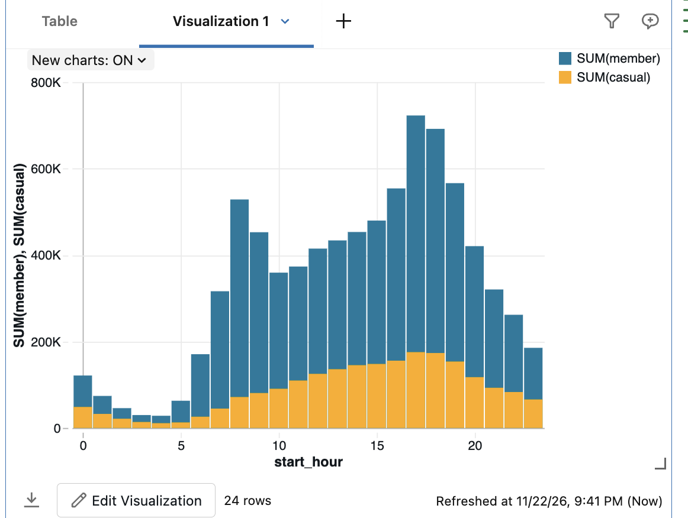
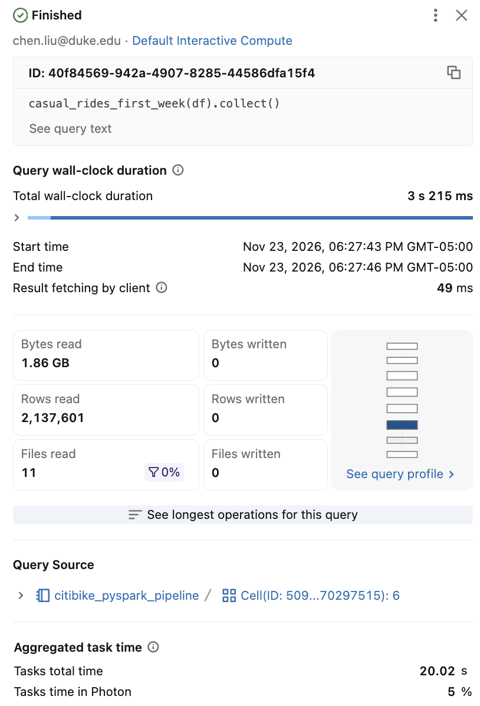
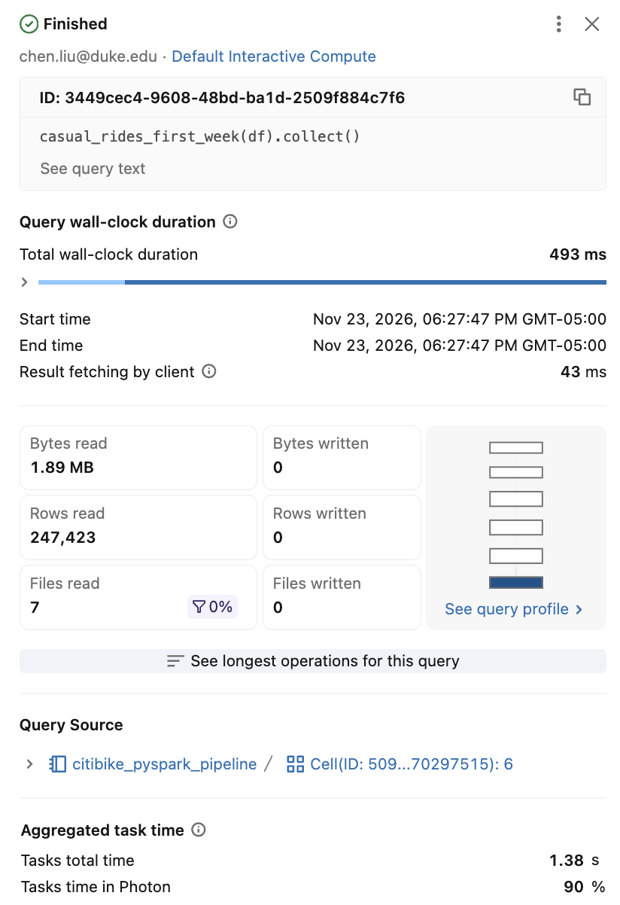
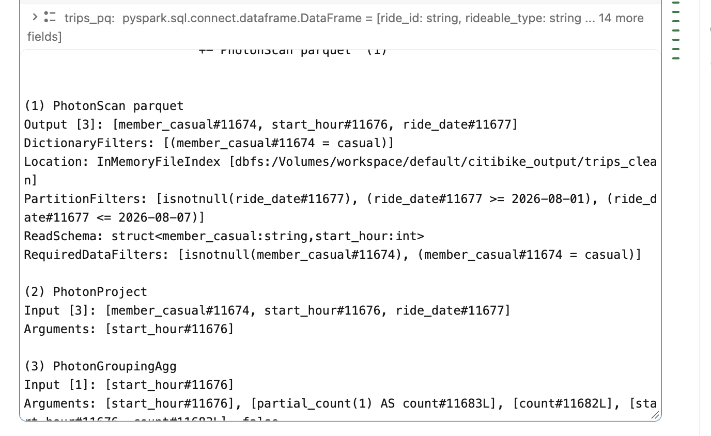
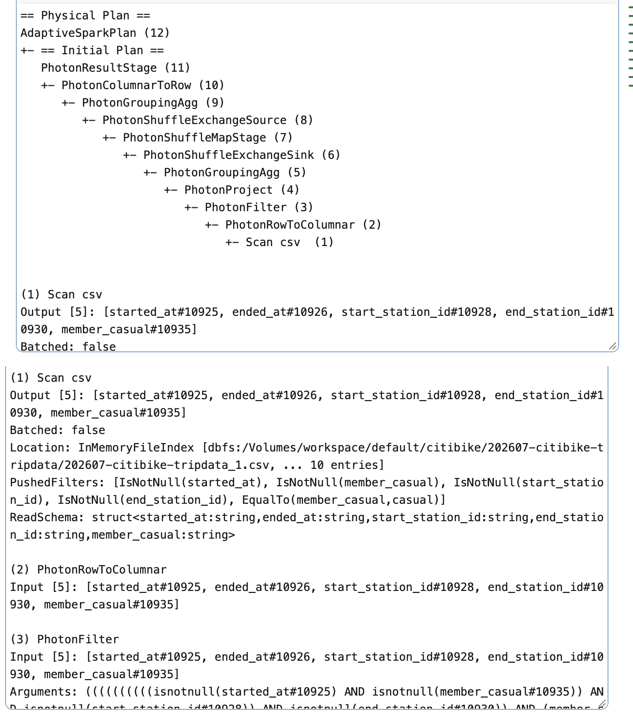
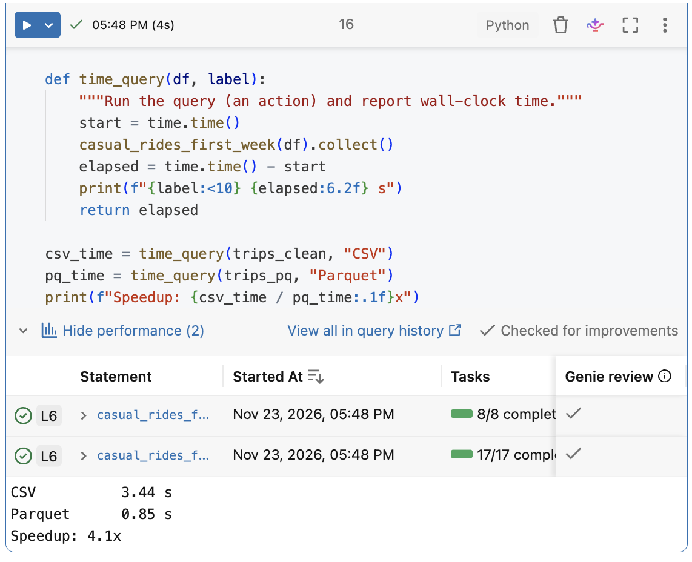

# Citi Bike NYC — PySpark Data Processing Pipeline

A PySpark pipeline on Databricks (Free Edition, serverless compute) that cleans, enriches, aggregates and stores **10.2 million Citi Bike trips from July–August 2026**, and then analyzes how Spark optimizes the work: lazy evaluation, filter pushdown, partition pruning, column pruning and shuffles.

## Repository Contents

| File | Description |
|---|---|
| `citibike_pyspark_pipeline.ipynb` | Databricks notebook with the full pipeline |
| `citibike_pyspark_pipeline.html` | HTML export of the executed notebook (all outputs visible) |
| `*.png` | Screenshots: execution plans, Query Details views and pipeline results |
| `README.md` | This file |

---

## 1. Dataset

**Source:** Citi Bike System Data, published by Lyft at <https://s3.amazonaws.com/tripdata/index.html>

**Files used:** `202607-citibike-tripdata.zip` and `202608-citibike-tripdata.zip` (New York City, not Jersey City)

| Property | Value |
|---|---|
| Time range | July 1 – August 31, 2026 (62 days) |
| Raw files | 11 CSV files (5 for July, 6 for August) |
| Raw size | ~2.0 GB uncompressed |
| Raw rows | 10,239,373 |
| Rows after cleaning | 10,203,608 |
| Columns | 13 raw + 3 derived |

Each row is one bike trip:

| Column | Meaning |
|---|---|
| `ride_id` | Unique trip ID |
| `rideable_type` | `classic_bike` or `electric_bike` |
| `started_at`, `ended_at` | Trip start and end timestamps |
| `start_station_name`, `start_station_id` | Where the trip started |
| `end_station_name`, `end_station_id` | Where the trip ended |
| `start_lat`, `start_lng`, `end_lat`, `end_lng` | Coordinates |
| `member_casual` | `member` (annual subscriber) or `casual` (pay-per-ride) |

The CSVs were uploaded to a Unity Catalog volume (`/Volumes/workspace/default/citibike/`) because Free Edition restricts outbound internet access.

---

## 2. Pipeline Overview

```
11 CSV files (2.0 GB)
   │  spark.read.csv  (header=true, glob path */*.csv)
   ▼
trips_raw ──withColumn──▶ trips            (typed timestamps/doubles + duration_min, ride_date, start_hour)
   │
   │  3 filters
   ▼
trips_clean (10,203,608 rows)
   ├── groupBy(start_hour, member_casual)          → hourly demand profile
   ├── groupBy start / end station + broadcast join → station net flow
   ├── Spark SQL query 1                            → bike type × rider type
   ├── Spark SQL query 2                            → weekday vs weekend
   └── repartition + write Parquet partitioned by ride_date
          ▼
   /Volumes/workspace/default/citibike_output/trips_clean/ride_date=YYYY-MM-DD/  (62 partitions)
          ▼
   read back → performance comparison (CSV vs Parquet)
```

### Requirement checklist

| Requirement | Implementation |
|---|---|
| Load data | `spark.read.option("header", "true").csv(".../citibike/*/*.csv")` |
| 2+ filters | (1) start/end station not null, (2) 1 min ≤ duration ≤ 24 h, (3) start date within July–August 2026 |
| 1+ join | Departures per station **broadcast-joined** with arrivals per station → `net_flow` |
| 1+ groupBy with aggregations | Rides and average duration by `start_hour` × `member_casual` |
| withColumn | Cast timestamps/coordinates; derive `duration_min`, `ride_date`, `start_hour`, `net_flow` |
| 2+ SQL queries | Bike-type comparison (with median via `PERCENTILE_APPROX`); weekday vs weekend daily averages |
| Filters early | All cleaning filters applied before any aggregation, join or write |
| Partitioning | Output written with `partitionBy("ride_date")`, after `repartition("ride_date")` to avoid many small files |
| Avoid unnecessary shuffles | Broadcast join; `pivot` with explicit values; partial aggregation before the groupBy shuffle |
| Write results | Parquet in a Unity Catalog volume (`trips_clean`, `station_flow`) |
| `.explain()` | Formatted physical plans for the same query on CSV and on Parquet |
| Actions vs transformations | Timed demo: 0.001 s to define transformations vs 0.876 s for the action |
| Caching (bonus) | `.cache()` timing test |

### Data cleaning

| Step | Rows |
|---|---|
| Raw | 10,239,373 |
| After filters 1 + 2 (stations, duration) | 10,204,420 |
| After filter 3 (July–August start date only) | **10,203,608** |
| Total removed | 35,765 (0.35%) |

Filter 3 was added after a data-quality check found **63 distinct dates instead of 62**. Citi Bike files group trips by month, so a few trips that started on June 30 and ended on July 1 were included. Counting that partial day as a full day lowered weekday averages, so those 812 trips were removed.

---

## 3. Key Findings

### Finding 1: Members commute, casual riders ride for leisure



- **Members** show two sharp peaks: **8 AM** and **5 PM**. This is a classic commuting pattern.
- **Casual riders** show one broad afternoon hump that peaks in the late afternoon. This is a leisure pattern.
- Overall demand is lowest around 4 AM and highest at 5 PM.

### Finding 2: Weekends flip the rider mix

| Day type | Rider type | Avg rides per day |
|---|---|---|
| Weekday (44 days) | casual | 29,603 |
| Weekday (44 days) | member | 135,238 |
| Weekend (18 days) | casual | 46,375 |
| Weekend (18 days) | member | 117,547 |

- Casual riding is **57% higher** on weekends.
- Member riding is **13% lower** on weekends.

This confirms Finding 1 from a different angle: members ride for work, casual riders ride for fun.

### Finding 3: E-bikes dominate, and casual riders take longer trips

| Bike type | Rider type | Rides | Avg duration (min) | Median duration (min) |
|---|---|---|---|---|
| classic_bike | casual | 507,993 | 23.40 | 16.27 |
| classic_bike | member | 2,224,547 | 11.84 | 8.03 |
| electric_bike | casual | 1,629,292 | 17.89 | 12.48 |
| electric_bike | member | 5,841,776 | 11.97 | 9.15 |

- E-bikes account for about **73% of all trips**.
- On classic bikes, the median casual trip (16.3 min) is **twice as long** as the median member trip (8.0 min).
- Members keep trips short (8–9 min median) regardless of bike type, which is consistent with point-to-point commuting.
- Only about 7% of e-bike trips last longer than 30 minutes (520,300 trips).

### Finding 4: Some stations constantly lose bikes

`net_flow = arrivals − departures`. Negative values mean a station drains and needs bikes trucked in (rebalancing).

| Station | Departures | Arrivals | Net flow |
|---|---|---|---|
| Allen St & Hester St | 14,737 | 6,038 | **−8,699** |
| E 17 St & Broadway | 29,987 | 23,674 | −6,313 |
| E 58 St & 1 Ave (NW Corner) | 10,220 | 3,920 | −6,300 |
| Grand St & Wythe Ave | 10,304 | 4,244 | −6,060 |
| Schermerhorn St & Hoyt St | 14,146 | 8,683 | −5,463 |

Allen St & Hester St loses about **140 bikes per day** on net. Without rebalancing it would be empty most of the time.

---

## 4. Performance Analysis

To compare sources fairly, the **same query** was run on the CSV-based DataFrame and on the Parquet output: count casual trips by start hour for August 1–7.

```python
df.filter(F.col("ride_date").between("2026-08-01", "2026-08-07")) \
  .filter(F.col("member_casual") == "casual") \
  .select("start_hour").groupBy("start_hour").count()
```

### Results

| Source | Time | Tasks |
|---|---|---|
| CSV | 3.31 s | 17 |
| Parquet (partitioned by date) | 0.57 s | 8 |
| **Speedup** | **5.8×** | |

Metrics from the Databricks **Query Details** view for the same two runs:

| Metric | CSV | Parquet | Difference |
|---|---|---|---|
| Bytes read | 1.86 GB | 1.89 MB | ~1,000× less data |
| Rows read | 2,137,601 | 247,423 | 8.6× fewer rows |
| Files read | 11 | 7 | only the 7 date partitions for Aug 1–7 |
| Total task time | 20.02 s | 1.38 s | 14.5× less compute |
| Task time in Photon | 5% | 90% | CSV parsing cannot run in Photon |
| Wall-clock duration | 3.2 s | 0.49 s | |

The numbers line up with the plans below:

- **Bytes read: 1.86 GB vs 1.89 MB.** CSV has to be scanned in full. Parquet reads only 7 partitions and only 2 columns, so almost nothing is read from disk.
- **Rows read: 2.1 M vs 247 K.** The CSV scan still returned every casual ride from both months, because the date filter can only be checked after parsing. Parquet skipped 55 of the 62 days before reading any rows.
- **Photon 5% vs 90%.** The CSV scan is row-based (`Scan csv` → `PhotonRowToColumnar`), so most of the work happens outside Databricks' vectorized Photon engine. The Parquet scan is columnar end to end and runs almost entirely in Photon.





### How Spark optimized the query

**Parquet plan.** The scan node shows three optimizations working together:

```
(1) PhotonScan parquet
PartitionFilters:  [isnotnull(ride_date), (ride_date >= 2026-08-01), (ride_date <= 2026-08-07)]
DictionaryFilters: [(member_casual = casual)]
ReadSchema:        struct<member_casual:string,start_hour:int>
```

- **Partition pruning:** `PartitionFilters` on `ride_date` means Spark opened only 7 of the 62 date folders. The other 55 days were never read.
- **Filter pushdown:** the `member_casual = casual` filter was pushed into the scan (`DictionaryFilters` / `RequiredDataFilters`), so non-matching rows were dropped while reading.
- **Column pruning:** `ReadSchema` contains only 2 of the 16 columns. Because Parquet is columnar, the other 14 columns were never touched on disk.

**CSV plan.** The same query on CSV shows where the bottleneck comes from:

```
(1) Scan csv
PushedFilters: [IsNotNull(started_at), IsNotNull(member_casual), IsNotNull(start_station_id),
                IsNotNull(end_station_id), EqualTo(member_casual,casual)]
ReadSchema: struct<started_at:string,ended_at:string,start_station_id:string,
                   end_station_id:string,member_casual:string>
(3) PhotonFilter
Arguments: ... (cast(started_at as timestamp) >= 2026-08-01 00:00:00) AND
               (cast(started_at as timestamp) <  2026-08-08 00:00:00) AND
               ((unix_timestamp(ended_at) - unix_timestamp(started_at)) / 60.0 >= 1.0) ...
```

- **Catalyst reorders filters automatically.** `member_casual = casual` was written *last* in the code but was pushed into the scan *first*. The order in the code does not decide the execution order; the optimizer does.
- **Filters on derived columns cannot be pushed down.** Catalyst rewrote `ride_date BETWEEN ...` into a range on `cast(started_at as timestamp)`. Because that still requires parsing and casting a string, it stays in a separate `PhotonFilter` after the scan. The same applies to the duration filter. This is why storing clean, typed, partitioned data pays off.
- **CSV is row-based.** Even though `ReadSchema` lists only 5 columns, Spark must still parse every byte of all 11 files to find those columns. There are no folders to skip, which is why the CSV run needed 17 tasks versus 8 for Parquet.

### Bottlenecks identified

1. **Re-reading raw CSV on every action.** Each action (`count`, `display`, `write`) re-scanned all 11 CSV files because transformations are lazy and nothing is stored by default. Writing a clean Parquet copy once and reading it back removed this cost (5.8× faster).
2. **The groupBy shuffle.** Both plans contain exactly one shuffle (`PhotonShuffleExchangeSink/Source`, `hashpartitioning(start_hour)`). Its cost is small because Spark runs a **partial aggregation** (`PhotonGroupingAgg (5)`) on each executor first, so only one small count per hour per task is shuffled, not millions of rows.
3. **Small-files risk on write.** Writing with `partitionBy("ride_date")` alone would let every task write a file into every date folder. Adding `repartition("ride_date")` first costs one shuffle but produces one file per day, which makes later reads faster.
4. **Stale partitions on overwrite.** Re-running the write with `mode("overwrite")` left an old `ride_date=2026-06-30` folder in place after the data no longer contained that date. Deleting the output folder before writing (`dbutils.fs.rm(..., recurse=True)`) fixed it. Otherwise the stale data would have been silently included when reading the Parquet back.

### How the pipeline was optimized

| Technique | Where |
|---|---|
| Filter early | All 3 cleaning filters run before any aggregation, join or write |
| Column pruning | `select` only the needed columns; Parquet's columnar format enforces it at read time |
| Partitioning | `partitionBy("ride_date")` enables partition pruning for date-range queries |
| Broadcast join | `F.broadcast(arrivals)` sends the small table (~2,000 stations) to every executor, so the join needs no shuffle |
| Explicit pivot values | `.pivot("member_casual", ["member", "casual"])` skips the extra job Spark would otherwise run to discover distinct values |
| Columnar storage | Parquet instead of CSV for all downstream queries |

### Screenshots

| Screenshot | File |
|---|---|
| Parquet query physical plan (`.explain()`) | [`explain_parquet.png`](explain_parquet.png) |
| CSV query physical plan (`.explain()`) | [`explain_csv.png`](explain_csv.png) |
| Query Details — Parquet query | [`query_details_parquet.png`](query_details_parquet.png) |
| Query Details — CSV query | [`query_details_csv.png`](query_details_csv.png) |
| Query Details — task counts (8 vs 17 tasks) | [`query_details_task_counts.png`](query_details_task_counts.png) |
| CSV vs Parquet timing | [`timing_csv_vs_parquet.png`](timing_csv_vs_parquet.png) |
| Successful pipeline execution (62 partitions, row count, date range) | [`output_verification.png`](output_verification.png) |
| Station net-flow join result | [`station_net_flow_join.png`](station_net_flow_join.png) |
| SQL query 1 result | [`sql_query1_bike_type.png`](sql_query1_bike_type.png) |
| SQL query 2 result | [`sql_query2_weekday_weekend.png`](sql_query2_weekday_weekend.png) |
| Actions vs transformations demo | [`lazy_vs_eager_demo.png`](lazy_vs_eager_demo.png) |
| Cache timing | [`cache_timing.png`](cache_timing.png) |







---

## 5. Actions vs Transformations

```python
t0 = time.time()
lazy_df = (trips_pq
           .filter(F.col("rideable_type") == "electric_bike")
           .withColumn("is_long_ride", F.col("duration_min") > 30)
           .groupBy("is_long_ride").count())
t1 = time.time()            # transformations defined
result = lazy_df.collect()  # action
t2 = time.time()
```

| Step | Time |
|---|---|
| Define `filter` + `withColumn` + `groupBy` (transformations) | **0.001 s** |
| `collect()` (action) | **0.876 s** |

Transformations are **lazy**: Spark only records them as a plan, like writing a shopping list. Actions are **eager**: they make Spark optimize the whole plan and actually read and process the data.

The same behavior appeared in other places:

- `spark.read.csv(...)` returned in 3 s. It only listed the files and read the header line. `count()` then scanned all 10.2 M rows.
- A typo in the file path did **not** raise an error when the DataFrame was defined. It only failed when an action ran, because no data had been read yet.
- Editing the filter cell did not change the Parquet files until the `write` action was re-run.

---

## 6. Caching (Bonus)

```python
cached_df = trips_pq.filter(F.col("member_casual") == "casual").cache()
cached_df.count()   # 1st run: reads data and fills the cache
cached_df.count()   # 2nd run: served from cache
```

| Run | Time |
|---|---|
| 1st `count()` (fills cache) | 0.56 s |
| 2nd `count()` (from cache) | 0.46 s |

The second run was about **18% faster**. The gain is modest because the source is already a pruned, columnar Parquet scan that takes under a second. Caching pays off most when the upstream work is expensive (for example parsing raw CSV) **and** the same DataFrame is reused by several actions. In this pipeline, persisting the cleaned data as Parquet achieved the larger benefit (5.8×) and also survives session restarts, which an in-memory cache does not.

---

## 7. How to Run

1. Download `202607-citibike-tripdata.zip` and `202608-citibike-tripdata.zip` from <https://s3.amazonaws.com/tripdata/index.html> and unzip them.
2. In Databricks, create the volume `workspace.default.citibike` and upload both folders.
3. Import `citibike_pyspark_pipeline.ipynb`, attach **Serverless** compute and click **Run all**.
4. Outputs are written to `/Volumes/workspace/default/citibike_output/`.

**Environment:** Databricks Free Edition, serverless compute, PySpark (Spark Connect), Photon engine.
